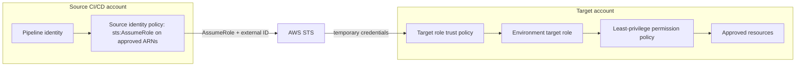

# Cross-Account IAM Automation: Terraform + Python

Code Clinic Lab 4 — a code-only reference project for narrowly scoped CI/CD role assumption across AWS accounts. No AWS account access, role deployment, or live STS call is required for validation.

## Problem and architecture

A centralized CI/CD identity needs temporary access to approved resources in development, staging, and production accounts. The source identity policy limits which role ARNs may be requested. Each target role trust policy names one source role and requires an external ID. The target role's permissions are separately scoped to approved resources.



This depicts an intended architecture only. The external ID is a confused-deputy control for integrations; it is not an authentication credential and does not replace a narrowly scoped trusted principal.

## Repository layout

- `terraform/modules/cross_account_role`: target role, trust and permission policies.
- `terraform/modules/source_assume_role_policy`: source-side allow policy.
- `terraform/environments/{dev,stage,prod}`: same modules with environment-specific examples.
- `src/cross_account_iam`: configuration, offline policy checks, safe STS adapter, CLI.
- `examples/`, `config/`: synthetic policy and configuration fixtures.
- `terraform/environments/dev/tests/`: native Terraform test using mocked AWS provider data.
- `tests/`: Python unit and CLI tests with mocked AWS SDK calls.
- `.github/workflows/validation-ci.yml`: offline validation only.

## Prerequisites

Python 3.11+, Terraform 1.7+, AWS provider 5.x, and optionally TFLint and Checkov. Python tests need pytest, pytest-cov, Ruff, Bandit, Boto3, and PyYAML (installed by `pip install -e '.[dev]'`). No AWS credentials are needed for tests or the validation CLI.

## Terraform use

Each environment directory is independently initialized. Copy its `terraform.tfvars.example` to an untracked `terraform.tfvars`, configure named AWS CLI profiles for source and target accounts, and provide `external_id` via `TF_VAR_external_id` from an approved secret source. Never commit a real external ID. Examples use documentation-only account IDs and artifact resources. Production defaults to read-only selected actions and demonstrates a permissions boundary. Terraform state can contain the external ID inside the trust policy; production must use encrypted, access-controlled remote state with locking and never publish state artifacts.

```sh
cd terraform/environments/dev
terraform init -backend=false
terraform fmt -check -recursive
terraform validate
terraform plan
```

`plan` reads configuration and proposes changes; do not run `apply` in this code-only lab. Terraform manages declared desired state, can detect drift during refresh/plan, and reconciles changes when applied by an authorized operator. Idempotency of a live deployment has not been tested.

The target module accepts actions and resource ARNs as inputs, rejects broad administrator patterns and wildcard resources, and builds trust JSON with `aws_iam_policy_document`. The source module scopes `sts:AssumeRole` to a supplied set of role ARNs. IAM authorization is the intersection of source identity permission, target trust, target permissions, session policies, permissions boundaries, and applicable SCPs; these policy types are not interchangeable.

## Python CLI

Run from the project root:

```sh
python -m cross_account_iam.cli validate-config --config config/config.example.yaml
python -m cross_account_iam.cli validate-policy --trust-policy examples/trust-policy.example.json --source-policy examples/source-policy.example.json --target-policy examples/target-policy.example.json
python -m cross_account_iam.cli report --config config/config.example.yaml --output validation-report.json
python -m cross_account_iam.cli --help
```

The commands parse local files only. The reusable `assume_role` function requires an explicitly injected STS client and is not called by the CLI. It validates role ARN, external ID, duration and STS response, returns credentials in memory, never logs credential values, and supports SDK retries configured by the caller. Optional caller identity verification is exposed separately and also requires an injected client.

## Security model

- **Trust policy:** target role resource policy that names the source role and requires `sts:ExternalId`.
- **Source identity policy:** allows only `sts:AssumeRole` on approved target role ARNs.
- **Target permission policy:** actions and resources available after assumption; examples show S3 artifact and ECR read operations. ECR `GetAuthorizationToken` requires `Resource: "*"` per IAM action authorization and is isolated/documented.
- **Permissions boundary:** caps permissions a principal can receive; does not grant permissions.
- **SCP:** organization guardrail that limits maximum available permissions; does not grant permissions.
- **Resource-based policy:** grants access on a resource and is not implemented here.

Use temporary STS credentials; do not persist or print access key, secret key, session token, or external ID. CloudTrail can audit AssumeRole in a future authorized environment but is not provisioned here. A role's maximum session duration and role chaining can reduce the effective duration. Production access should use a review/approval process outside this project. Static checks do not replace IAM Access Analyzer or full AWS policy evaluation.

## Tests and CI

```sh
ruff check .
ruff format --check .
bandit -q -r src
pytest --cov=cross_account_iam --cov-report=term-missing --cov-fail-under=85
terraform fmt -check -recursive
terraform -chdir=terraform/environments/dev init -backend=false
terraform -chdir=terraform/environments/dev validate
```

The GitHub Actions workflow uses least-privilege read permissions and synthetic fixtures. It does not configure AWS credentials/OIDC, call live STS, deploy infrastructure, or run apply/destroy. Terraform init may download providers but does not contact an AWS account.

## Troubleshooting

- **AccessDenied:** verify source `sts:AssumeRole` resource ARN, target trusted principal, external ID, SCPs, boundary, and session policy.
- **External ID mismatch:** compare injected value with the target trust condition without printing it.
- **Invalid role ARN / duration:** check ARN account and role path; session duration must meet STS and target role limits (3600–43200 seconds, with role chaining limited to one hour).
- **Policy rejected:** validate JSON and action/resource compatibility; some list/describe operations require wildcard resource scope.
- **Terraform validation error:** run `terraform fmt`, inspect variable constraints and provider versions; validation is static and does not prove runtime authorization.

## Limitations and future work

No AWS account was accessed, no IAM role or policy was deployed, no live STS call or cross-account test was performed, and no CI deployment occurred. Future extensions could integrate GitHub OIDC, IAM Access Analyzer, CloudTrail review, or organization-wide rollout after separate authorization.

## Original assignment

Implement a reusable Terraform + Python hybrid that creates a cross-account IAM role-assumption pattern with external ID and least-privilege policies for a CI/CD pipeline. Required deliverables include reusable modules, dev/stage/prod examples, Boto3 STS logic, offline policy validation, tests, CI, and security documentation. This repository implements the assignment as code and offline checks only.
